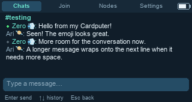

# MeshCore for Cardputer Zero

Standalone MeshCore messaging for M5Stack Cardputer Zero with the SX1262 LoRa
CAP. Chat over LoRa without a phone, companion radio, or internet connection.




## Requirements

- Cardputer Zero with the SX1262 LoRa CAP and a suitable antenna.
- The Debian 13 / ARM64 image with Python 3.13 and APPLaunch.
- Matching radio settings on the other nodes you want to reach.

This is early-access software. US operation has been tested; EU presets are
included, but EU over-the-air validation is still pending.

## Install

### App store — recommended

Open **Store** on your Cardputer Zero, search for **MeshCore** or enter share
code **MCZR**, then install it. Open **MeshCore** from APPLaunch afterward.

[View MeshCore in the Cardputer app store](https://cardputer.cc/#/apps/MCZR)

The store listing shows the available version. **v0.1.13** adds a MeshZero
background-service warning. Close MeshZero’s background service before opening
MeshCore so the two apps do not share the CAP. See the
[troubleshooting options](#troubleshooting-meshcore-freezes-or-cannot-use-the-lora-cap)
below.

### GitHub release — manual alternative

To install directly from GitHub instead, SSH into your Cardputer Zero and run:

```sh
mkdir -p "$HOME/.cache/meshcore-zero"
curl -fL https://github.com/unagisan69/meshcore-zero/releases/latest/download/meshcore-zero_arm64.deb -o "$HOME/.cache/meshcore-zero/meshcore-zero.deb"
sudo apt install "$HOME/.cache/meshcore-zero/meshcore-zero.deb"
```

If you prefer `wget`, use it for the download instead:

```sh
mkdir -p "$HOME/.cache/meshcore-zero"
wget -O "$HOME/.cache/meshcore-zero/meshcore-zero.deb" https://github.com/unagisan69/meshcore-zero/releases/latest/download/meshcore-zero_arm64.deb
sudo apt install "$HOME/.cache/meshcore-zero/meshcore-zero.deb"
```

Open **MeshCore** in APPLaunch. If the icon has not appeared, refresh or restart
the launcher. Application updates preserve your identity, channels, and history.

## Update

At startup, MeshCore checks GitHub for a newer stable release when the device has internet access. If one is available, **Update** is selected by default; press **Enter** to continue, or choose **Later** / press **Esc**. Offline checks are skipped quietly and do not block radio startup.

In **Settings → Update app**, check GitHub for a newer release, press Enter to
download it, then enter your device’s sudo password to install. The password is
used only for that installation and is never saved or sent to GitHub. Keep power
connected during installation; the app restarts when finished. Updates preserve
your local identity, channels, and messages. This checks GitHub releases and may
install a version newer than the app-store version.

The update screen separates downloading, verification and installation. It shows
received/total MiB and a percentage when the server provides a size, elapsed
time, and the package manager's installation progress. An activity bar is used
when a stage has no measurable percentage.
These indicators are available after installing v0.1.19; older versions use
their existing update screen for that first installation.

The in-app updater uses private on-disk caches for package downloads and staging
to reduce RAM use. Temporary package copies are removed when the operation ends.

If an update is slow, its stage timings and outcomes are recorded locally in
`~/.local/share/meshcore-zero/update.log` (under your selected data directory if
overridden). The log rotates after 256 KiB and keeps one previous copy. It
contains timing fields, not passwords or messages. For installer errors, inspect
`sudo tail -n 80 /var/log/meshcore-zero-update.log` over SSH.

## Using MeshCore

- **Tab** cycles through Chats, Join, Nodes, Map, and Settings and immediately displays each page. **Enter** acts on the visible page.
- **Up/Down** selects a conversation or scrolls chat history. Use the keyboard's
  Fn arrow combinations where necessary.
- In the **Chats conversation list**, **F** moves up and **X** moves down;
  **Fn+F / Fn+X** continue to work. F and X type normally in messages and forms.
- Type in a conversation and press **Enter** to send.
- **Escape** returns to Chats; Escape again exits to the launcher.
- **Join** lets you choose **Hashtag**, **Private**, or **Public**. Use **Left/Right**
  on Type and **Up/Down** between fields. Hashtag is selected every time Join
  opens, with any hashtag-name draft preserved. Hashtag names start with `#`; an extra
  leading `#` is harmless. For Private, enter a local name and the shared key,
  then select **Join private**. For Public, select **Join / open Public**.
- In **Chats**, highlight a channel and press **Backspace** for **Channel options**: mute/unmute notifications, Scope, clear history, or leave. Confirm **Leave** to remove that channel and its saved messages from this device; **Cancel** is selected by default. Muted channels keep receiving messages and unread counts, without chimes or notification toasts. Clearing history keeps the channel joined. Direct messages are unaffected. To rejoin Public, open **Join**, select **Public** with Left/Right on Type, then choose **Join / open Public**.
- **Nodes** lists discovered nodes. Select a chat node and press Enter to start
  a direct message. Repeaters and room servers remain visible in the list.
- Select a **Repeater** and press **Enter**, then confirm **Request Status** and enter its password. The password is masked. After entry, choose whether to save it (**No** is selected by default). A successful status request saves it encrypted on this device if you choose **Yes**; future requests reuse it for that repeater. Press **Backspace** on the repeater confirmation or status screen to forget it. Status shows battery voltage and an approximate single-cell Li-ion percentage, uptime, noise floor, last SNR and the repeater's UTC clock. Unsupported clock queries show **Unavailable**; other battery types may not have a meaningful percentage.
- After startup checks and any update decision, MeshCore sends one flood advert to introduce your node. You can also use **Settings → Announce this node**.
- **Settings** controls region, coding rate, node name, announcements, message sound, identity import/export, encrypted backup/restore, GPS broadcasting, and app updates.
- The display follows the system **Settings → Screen → DarkTime** timeout, including **Never**. The first keypress wakes the screen without activating anything. Messages continue arriving while the screen is dark.
- New channel messages and DMs play a short chime at the system volume. System mute silences it; **Settings → Message sound** switches it off for MeshCore. Receiving a message does not wake the screen.

The inbox combines channels and direct messages, with message previews and
unread counts. A **globe** marks Public, **#** marks hashtag channels, a **lock** marks private
channels, and **@** marks direct messages. Names and messages support offline color Unicode emoji.

## Troubleshooting: MeshCore freezes or cannot use the LoRa CAP

Recent **MeshZero** versions have **Run in background disabled by default**.
They stop the radio about **10 seconds after the app closes**, allowing other
apps to use the LoRa CAP and GPS. Background operation is now opt-in; having
MeshZero installed does not by itself mean it is causing a conflict. See
[MeshZero's current background-mode documentation](https://github.com/s0liton/MeshZero#running-in-the-background).

To switch apps, close MeshZero, wait about 10 seconds for it to release the
hardware, then open MeshCore. If you previously enabled **Setup → Run in
background**, switch it **Off** first. Older installations may retain their
existing preference, so check that setting after updating.

**MeshCore's current detection limitation:** MeshCore checks whether
`meshzero.service` is active, rather than whether its radio is actually in use.
The service can remain active even after MeshZero releases the CAP, so a warning
can still appear with background operation off. This warning does not prove the
newer MeshZero is still holding the radio. If it persists after waiting, stop the
service temporarily through SSH or the Cardputer CLI:

```sh
sudo systemctl stop meshzero.service
```

Then press **Okay** in MeshCore to check again, or **Esc** to exit. MeshCore does
not stop other services automatically. Exit MeshCore before opening MeshZero or
another radio app. You do **not** need to uninstall MeshZero for normal use.

For an older setup where you deliberately want to prevent service startup at
boot, this is optional:

```sh
sudo systemctl disable --now meshzero.service
```

This changes MeshZero's service startup, not just its background preference.
To restore it later, first exit MeshCore, then run:

```sh
sudo systemctl enable --now meshzero.service
```

Uninstalling is only necessary if you no longer want MeshZero installed. Back up
its identity/configuration first, then remove it through the app store or with
`sudo apt remove meshzero`. Removing MeshZero is not a required compatibility
step for its newer default behaviour.

If these steps do not resolve a freeze, report your MeshCore version, OS image,
CAP revision, and error log. A radio conflict is one possible cause, not a
diagnosis of every freeze. Never post your identity database or private keys in
an issue.

## Radio settings and CAPs

Both the current **Cap LoRa-1262** and the legacy **Cap LoRa868** are detected
automatically. Settings shows the detected model. The legacy CAP does not need
the newer board’s antenna-switch expander.

**Settings → Region** includes the full MeshCore community preset catalog,
including **Hungary**, Brazil, Costa Rica, Australian variants, Netherlands
(Limburg), New Zealand (Gisborne), USA (Southern California), and legacy presets.
Hungary uses **869.618 MHz / SF7 / BW62.5 / CR4/5 / 2-byte paths**.
Japan (experimental), Scotland / ScotMesh, and the legacy EU profile remain
available alongside the API list.

Presets refresh quietly from the [MeshCore configuration API](https://api.meshcore.nz/api/v1/config)
at startup when the cache is over 24 hours old. Press **R** in the Region
picker to refresh immediately. A validated local cache and bundled snapshot
keep the list available offline; a failed refresh keeps the last good list.
No account or device identity is sent to that API.

Choose a preset with Up/Down and Enter, then restart to apply it. Refreshing
only updates the list: it never retunes your radio. The selected profile is
saved as a snapshot, including its path-size default, and remains unchanged
until you select it again. Existing identities, channels, legacy settings,
and per-profile coding-rate/scope/path overrides are preserved. Full encrypted
backups include downloaded and selected profiles for offline restoration.

Presets within the CAPs’ documented **868–923 MHz** range work as before.
Nearby upper-900 MHz presets, including **USA - Southern California (927.875 MHz)**,
can be selected experimentally after a **Cancel-first warning**. The complete
occupied bandwidth must stay at or below 928 MHz; 433 MHz and more distant
bands remain blocked. Select **Use experimentally**, then restart to apply.

Acceptance is remembered for that preset’s exact RF parameters and is included
in encrypted backups. If an upstream preset changes those parameters, selecting
it again requires fresh confirmation. This bypasses MeshCore-Zero’s previous
app-side limit; it does not establish the CAP’s RF performance outside its
published range. Operation, sensitivity and output quality at these frequencies
have not been verified, so reduced efficiency or reliable operation cannot be
promised. Match your local mesh, hardware and radio rules.

**Settings → Scope / path hash** lets you override the selected preset’s region
scope and choose **1, 2 or 3 bytes** for outgoing path hashes. Enter the scope
name used by your local mesh (for example `sco` or `eng-ne`); a leading `#` is
optional. Leave the field blank for unscoped floods. Overrides are saved per
regional preset; restart the app to apply them before the startup advert.
**Reset to region preset** restores that profile’s scope and path size without
changing its frequency or coding rate. Encrypted full backups include these
settings. Existing installations keep their preset defaults until changed.

For a single channel, highlight it in Chats, press **Backspace**, and select
**Scope**. A blank channel override inherits the active region-wide scope.
The channel menu and chat header show the running radio’s scope while saved
region-wide changes await a restart. Scopes control flood routing, not channel
encryption or radio frequency. Match your local mesh; older repeaters may not
forward multi-byte paths (see the [MeshCore firmware FAQ](https://github.com/meshcore-dev/MeshCore/blob/main/docs/faq.md)).

Japan uses 920.800 MHz / SF12 / BW125 / CR4/8 at 13 dBm, with energy-based
listen-before-talk and per-packet airtime limits. Text is limited to 16 UTF-8
bytes including a channel’s sender prefix. This is experimental and does not
establish Japanese equipment certification. Use an appropriately approved setup.

See [radio profiles and CAP compatibility](docs/radio.md) for exact settings,
Japan limitations, hardware detection, and field-test coverage. A hashtag channel
changes its shared key, not the radio frequency.

## Message indicators

Small green circles mean a matching radio echo or DM acknowledgement returned.
Muted grey circles mean no confirmation has returned yet.

A transmitted channel message can be heard by another device without any
response returning. A heard indication appears only when MeshCore receives a
matching copy of the message back over the radio. It does not confirm delivery
to every channel member. No confirmation does not mean the transmission failed.
Direct messages can receive an explicit delivery acknowledgement.

Public and hashtag channels are shared channels: anyone with the same channel
name/key can read them. Channel display names are not authenticated identities.

The **Scotland · ScotMesh** preset uses the UK/EU radio settings (869.618 MHz,
BW62.5, SF8, CR4/8), 3-byte path hashes, and default flood scope **sco**.
Restart to apply it. The default scope covers channel floods and startup/manual
flood adverts; joining a channel does not select a separate scope. In **Chats → Backspace →
Scope**, enter an override such as `edi`, `gla`, `ioi`, `wls` or `eng-ne`.
Clear the field to inherit the regional default. The effective scope appears in
the chat header. An override affects future outgoing channel floods, including
Public; it does not filter incoming messages or change adverts/other channels.
See the [ScotMesh setup guide](https://wiki.scotmesh.uk/en/MeshCore/getting-started).

## Private channels

Choose **Join → Type: Private**. Enter a channel name (1–32 UTF-8 bytes, without
an initial `#`) and its shared **16-byte key**: either **32 hexadecimal
characters** or **Base64** (normally 24 characters, including padding). Standard
and URL-safe Base64 are accepted. This is a channel key, not a node's private
identity key or a passphrase. Obtain it securely from the private channel's owner
or create one in a compatible MeshCore client.

The name is a local label; the shared key determines which messages the devices
can decrypt. Keys are masked on entry and cleared from the form when you leave. Shared keys
are stored in the app's private local database; keep that directory private.
Known Public/zero keys and keys derived from that name as a hashtag are rejected.
Joining a key already present opens its existing conversation without replacing
its history. Private channels support the same mute, scope, clear and leave
options as other channels. No key is shown in chat titles, logs or notifications.

Private channel configuration and messages are included in encrypted `.mczb`
backups. Restoring a backup containing private channels requires v0.1.24 or
later; older backups remain supported. Anyone with the shared channel key can
read its traffic. Public and hashtag keys are publicly known or derivable and
are not private-channel access control.

## Map and GPS

**Map** is a simple offline, north-up radar inspired by MeshZero's clean small-screen
layout. It uses your CAP's GPS position and the coordinates other nodes advertise.
It does not download street maps or estimate distance from signal strength.

- **Up/Down** or **+/−** zooms; **0** fits all positioned nodes.
- **Left/Right** selects a node; **Enter** shows its distance, bearing, position
  age, last advert reception and available RSSI/SNR. **Escape** returns to Map.
- **M** sets a manual fallback as `latitude, longitude` in decimal degrees.
  Clear that field to remove it. A fresh GPS fix takes priority; a lost fix is
  labelled **Last GPS** and used for up to five minutes before falling back.
- Chat nodes use blue dots, repeaters orange triangles, and room servers purple
  diamonds. The centre marker is you. Older/unknown-age positions are hollow grey;
  out-of-range nodes sit at the rim. Labels are limited to reduce overlap.
- Nodes without valid advertised coordinates remain in **Nodes**. Advert RX
  signal measurements describe the last radio leg, which may be a relay, not a
  direct link to the mapped node. Positions older than 24 hours are marked older.

Both supported CAPs provide GPS NMEA over the Zero's `/dev/serial0` UART (fallback
`/dev/ttyS0`) at 115200 baud. GPS is read while viewing Map or while broadcasting
is enabled. No receiver configuration commands are sent. The app restores the
port settings when it closes and leaves active GPS services/serial consoles
alone. GPS reception may require a clear view of the sky. If the port is busy or
no fix is available, use a manual fallback. Live GPS coordinates stay in memory;
only a position you enter manually is saved in the app database.

**Settings → GPS broadcasting** is **Off** by default. Enabling it asks for
confirmation before sharing your precise GPS position. When enabled, fresh fixes
are included in startup/manual adverts, and a location advert is sent after a
fresh fix becomes available and at most every 15 minutes thereafter, subject to
regional airtime limits. A fix must be no more than 15 seconds old. No-fix/stale GPS and
manual fallback positions are never broadcast. Turning sharing off clears the
advert location and cancels queued own-location adverts before transmission.
Map use alone does not enable sharing; GPS broadcasting continues with the
screen asleep until the app exits. Restoring a full backup also restores its
saved manual position and GPS broadcasting preference.

## Identity import and export

Open **Settings → Identity: import / export** to move an identity between MeshCore
firmware and this app. This uses the firmware's **64-byte expanded private key
(128 hexadecimal characters)**. Existing app identities are converted on export
without changing their public key. A 64-character public key or seed is not a
firmware private-key export and cannot be pasted here.

- **Import firmware key** accepts the 128-character key with masked entry.
- **Import from file** reads a plain-text key file. The default is
  `~/.local/share/meshcore-zero/identity-import.txt`; you can edit the path.
- Import previews the resulting **public key**, with **Cancel** selected by
  default. Confirming restarts the app with the new identity and keeps your
  channels, messages and saved repeater passwords. **Restore previous identity**
  lets you switch back to the last identity replaced through this menu.
- **Export firmware key** asks for confirmation, then writes
  `~/.local/share/meshcore-zero/identity-export.txt` with owner-only file access.
  It does not show the private key on screen. Exporting again replaces this file.

Paths follow your selected data directory if overridden. Keep key files and
backups private, and remove transfer files when finished. Avoid operating two
active devices with the same identity at once.

## Encrypted backup and restore

Open **Settings → Backup / restore**. **Create encrypted backup** asks for a
password twice (8–128 characters) and writes a private `.mczb` file under
`~/.local/share/meshcore-zero/backups/`. It includes your identity, previous
identity backup, settings, channels and scopes/mute choices, DMs, all saved
messages, discovered nodes and saved repeater passwords. Copy the file off the
device with your preferred SSH/SFTP tool. Keep the password separately: the app
does not save it and cannot recover a forgotten password.

**Restore encrypted backup** lists local backup files, or accepts another file
path. Copy a backup onto the device first. Enter its password to validate it and
preview its public identity and conversation counts. **Cancel** is selected by
default. Restoring replaces the entire local dataset, including radio settings;
it does not merge histories. Before replacement, an encrypted `before-restore-…`
recovery backup is saved with the same password you just entered. The radio stops,
data is replaced transactionally, and the app restarts with a result screen.
Use the recovery file through the same menu to undo a successful restore.

Backup encryption uses Argon2id password derivation and XSalsa20-Poly1305
(SecretBox) authentication. Wrong passwords and damaged or unsupported files are
rejected before any local data is replaced. Files are owner-readable only.
The current backup safety limits are 16 MiB of unencrypted data and 100,000 rows
per table; larger datasets
require the manual directory backup below. `.mczb` is MeshCore Zero's full-backup
format, separate from the firmware-compatible identity import/export above.
Avoid using the same restored identity on two active devices simultaneously.

## Your data

Identity, settings, contacts, channels, and messages stay in
`~/.local/share/meshcore-zero/` (or the directory selected by `XDG_DATA_HOME`).
Back up that directory to retain your identity and history. It contains private
key material, so keep backups private. Unsent drafts are currently kept only
while the app is running.

Optional saved repeater passwords are encrypted with a device-local key in that
same directory. Back up the whole directory to retain both the passwords and
their key. They are not uploaded to GitHub or included in app packages.

## Help and releases

- [Download releases](https://github.com/unagisan69/meshcore-zero/releases)
- [Report an issue](https://github.com/unagisan69/meshcore-zero/issues)
- [Changelog](CHANGELOG.md)

The app currently focuses on text chat. Attachments, room-server login, GPS,
and a custom frequency editor are not included.

Independent client using [openHop Core](https://github.com/openhop-dev/openhop_core)
and the [MeshCore protocol](https://github.com/meshcore-dev/meshcore).
See [LICENSE](LICENSE) and [third-party notices](THIRD_PARTY_NOTICES.md).

### Airtime and short conversations

Messages no longer have a fixed cooldown. European presets allow bursts of
short messages within a 10% rolling-hour transmit budget (360 seconds).
Accounting uses each encoded packet’s calculated LoRa airtime, including
adverts, acknowledgements and retries. The private local ledger survives
restarts and is separate from identity backups. Only an exhausted budget
blocks transmission; reception continues. Other presets have no artificial
message cooldown; Japan retains its packet, channel-sensing and 50 ms spacing
guards. Use the appropriate regional preset and comply with local radio rules.
