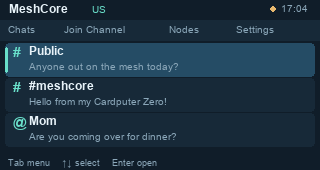

# MeshCore for Cardputer Zero

Standalone MeshCore messaging for M5Stack Cardputer Zero with the SX1262 LoRa
CAP. Chat over LoRa without a phone, companion radio, or internet connection.




## Requirements

- Cardputer Zero with the SX1262 LoRa CAP and a suitable antenna.
- The Debian 13 / ARM64 image with Python 3.13 and APPLaunch.
- Matching radio settings on the other nodes you want to reach.

This is early-access software. US operation has been tested; EU presets are
included, but EU over-the-air validation is still pending.

## Install

SSH into your Cardputer Zero, then run:

```sh
curl -fL https://github.com/unagisan69/meshcore-zero/releases/download/v0.1.7/meshcore-zero_0.1.7_arm64.deb -o /tmp/meshcore-zero.deb
sudo apt install /tmp/meshcore-zero.deb
```

If you prefer `wget`, use it for the download instead:

```sh
wget -O /tmp/meshcore-zero.deb https://github.com/unagisan69/meshcore-zero/releases/download/v0.1.7/meshcore-zero_0.1.7_arm64.deb
sudo apt install /tmp/meshcore-zero.deb
```

Open **MeshCore** in APPLaunch. If the icon has not appeared, refresh or restart
the launcher. Application updates preserve your identity, channels, and history.

## Using MeshCore

- **Tab** cycles through Chats, Join Channel, Nodes, and Settings; **Enter** opens.
- **Up/Down** selects a conversation or scrolls chat history. Use the keyboard's
  Fn arrow combinations where necessary.
- Type in a conversation and press **Enter** to send.
- **Escape** returns to Chats; Escape again exits to the launcher.
- **Join Channel** opens with `#` already entered. Type the channel name;
  entering another leading `#` is harmless.
- **Nodes** lists discovered nodes. Select a chat node and press Enter to start
  a direct message. Infrastructure nodes remain visible in the list.
- **Settings** controls region, coding rate, node name, and announcements.

The inbox combines channels and direct messages, with message previews and
unread counts. Names and messages support offline color Unicode emoji.

## Radio settings

| Profile | Frequency | Bandwidth | SF | Default coding rate | TX power |
| --- | --- | --- | --- | --- | --- |
| US | 910.525 MHz | 62.5 kHz | 7 | 4/5 | 20 dBm |
| EU | 869.618 MHz | 62.5 kHz | 8 | 4/5 | 14 dBm |

Set the profile and coding rate to match your local network, then restart the
app to apply radio changes. Coding rate cycles from 4/5 through 4/8 and is
saved separately for each profile. A hashtag channel changes its shared key,
not the radio frequency.

## Message indicators

A transmitted channel message can be heard by another device without any
response returning. A heard indication appears only when MeshCore receives a
matching copy of the message back over the radio. It does not confirm delivery
to every channel member. No confirmation does not mean the transmission failed.
Direct messages can receive an explicit delivery acknowledgement.

Public and hashtag channels are shared channels: anyone with the same channel
name/key can read them. Channel display names are not authenticated identities.

## Your data

Identity, settings, contacts, channels, and messages stay in
`~/.local/share/meshcore-zero/` (or the directory selected by `XDG_DATA_HOME`).
Back up that directory to retain your identity and history. It contains private
key material, so keep backups private. Unsent drafts are currently kept only
while the app is running.

## Help and releases

- [Download releases](https://github.com/unagisan69/meshcore-zero/releases)
- [Report an issue](https://github.com/unagisan69/meshcore-zero/issues)
- [Changelog](CHANGELOG.md)

The app currently focuses on text chat. Attachments, room-server login, GPS,
and a custom frequency editor are not included.

Independent client using [openHop Core](https://github.com/openhop-dev/openhop_core)
and the [MeshCore protocol](https://github.com/meshcore-dev/meshcore).
See [LICENSE](LICENSE) and [third-party notices](THIRD_PARTY_NOTICES.md).
